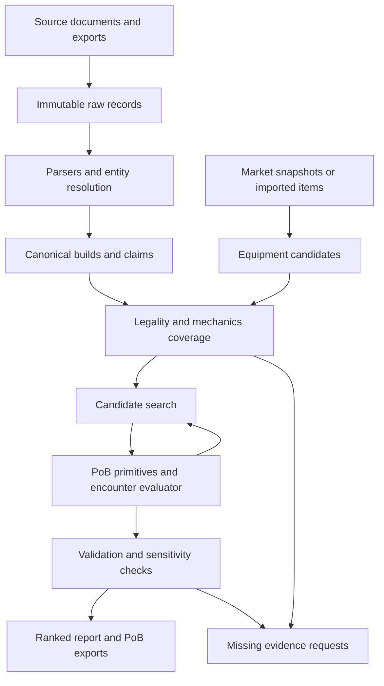

# System architecture

Use a local Python application with a coordinator process and isolated PoB worker processes. Keep the two existing packages. Avoid a rewrite of the Lua engine and avoid introducing a network service for internal calls.

## Data flow



## Module ownership

Paths below are proposed implementation locations; they do not already exist unless noted. Use small modules with functions and dataclasses. Do not build a plugin framework or inheritance hierarchy before a second implementation requires it.

| Location relative to repository | Responsibility | Must not do |
|---|---|---|
| `pob2-optimizer/pob2opt/domain/` | Validated records, canonical hashing, statuses, units | Network or Lua calls |
| `pob2-optimizer/pob2opt/storage/` | SQLite repository, immutable blobs, migrations | Rank builds |
| `pob2-optimizer/pob2opt/sources/` | Acquisition and source capability manifests | Turn guide claims into trusted rules |
| `pob2-optimizer/pob2opt/parsers/` | Source-specific extraction and canonical conversion | Silently fill missing modifiers |
| `pob2-optimizer/pob2opt/catalog/` | Patch-specific entities and compatibility profiles | Automatically approve a new patch |
| `pob2-optimizer/pob2opt/market/` | Item pool policy, snapshots, listing rechecks | Buy items or contact sellers |
| `pob2-optimizer/pob2opt/coverage/` | Mechanics dependencies, gaps and sensitivity plans | Infer trust from popularity |
| `pob2-optimizer/pob2opt/evaluation/` | Legality, PoB primitive adapter, scenario execution and score | Obtain network data mid-evaluation |
| `pob2-optimizer/pob2opt/search/` | Candidate generation, archive, scheduling and recovery | Manufacture performance labels |
| `pob2-optimizer/pob2opt/reporting/` | JSON and Markdown reports, evidence links | Recompute scores differently |
| `pob2-optimizer/pob2opt/learning/` | Optional offline experiments | Bypass legality or final verification |
| `pob2-mcp/pob2mcp/engine.py` and `bootstrap.lua` | Existing engine bridge, extend typed operations | Apply optimizer scoring policies |
| `pob2-mcp/pob2mcp/trade.py` and `poe_api.py` | Existing transport, repair or replace behind approved adapters | Supply implicit credentials or undocumented access assumptions |

`engine_worker.py` remains the process entry point. `cli.py` becomes a thin dispatcher to application services. Existing `phases.py`, `policy.py`, `concentration.py`, `calibration.py`, `ladder.py` and `harvest.py` remain a legacy comparison path until replacement tests pass. New production evaluation must not call their heuristic score functions.

## Dependencies and runtime

Retain Python 3.10 compatibility initially. Use standard-library dataclasses, enums, sqlite3, hashlib, decimal and multiprocessing. Add `jsonschema` for explicit persisted contracts and `pytest` as a development dependency. Pin tested dependency versions in a reproducible development requirements file during P00; do not invent current package versions in this spec. Existing `requests` handles approved HTTP acquisition. No LLM runtime is required for P00 through P10.

Pure parsing, storage, scoring and search-fixture tests must run without PoB, network credentials or a GPU. Real engine integration runs on a Windows machine with the accepted PoB checkout and runtime. A skipped integration test does not satisfy the engine gate.

## Process boundary

The coordinator owns absolute paths, manifest creation, network acquisition, the task queue and all database writes. A worker owns one PoB/Lua state, receives a complete immutable candidate and evaluation context, and returns a structured result. Use Windows `spawn`; never share a Lua pointer across processes or threads.

The existing engine changes process working directory. Until that dependency is removed, instantiate it only inside a worker. Resolve all application paths before spawning. The parent working directory must never change during evaluation.

Each worker fully loads the candidate before evaluation; importing an existing community build must not invoke `OPT_setup`, which clears gear, skills and passives. Candidate reset and engine cleanup are explicit operations. Native crashes require a new process, not merely resetting Lua tables.

## Local storage layout

```text
runs/<run_id>/
  manifest.json
  run.sqlite
  blobs/<sha256>
  artifacts/candidates/<build_hash>.json
  artifacts/exports/<build_hash>.xml
  artifacts/traces/<evaluation_id>.jsonl
  checkpoint.json
  report.json
  report.md
  events.jsonl
```

An optional user-selected corpus root contains `corpus.sqlite` and `blobs/`. A run copies the required content-addressed references and payloads into its own bundle so it does not depend on mutable corpus rows. Record `redacted`/`restricted` artifacts if redistribution is not allowed; distinguish reproducible local review from shareable export.

Use SQLite transactions with a single coordinator writer. Immutable payload tables store canonical JSON plus indexed identifiers; SQL columns index task state, run ID, build hash, source and status. Database schema migrations are numbered and tested. Blobs are SHA-256 addressed; verify hash on read. Write checkpoint JSON to a sibling temporary file, flush, and replace atomically. Database task states are authoritative after a crash.

## Evaluation identity and caching

The cache key includes canonical build hash, rotation hash, scenario hash, patch profile hash, catalog hash, PoB commit and dirty-tree hash, adapter version, mechanics registry hash, calibration artifact hash, fidelity, seed and evaluator version. The aggregate score cache additionally includes objective and baseline-suite hashes. Timestamps and listing prices do not affect combat identity; actual item properties do.

Reuse an evaluation only when every dependency matches. A lower-fidelity screen can never satisfy a finalist evaluation request. Old phase JSON files are historical imports, not valid new checkpoints.

## Error boundary

Return a typed result: `ok`, `invalid_input`, `legality_unknown`, `unsupported`, `timeout`, `engine_crash`, or `internal_error`. Store error code, stage, record references and a redacted diagnostic. Keep legitimate zero damage separate from missing damage. Never use `except: pass` in a production boundary.

Retry only classified transient acquisition errors or one fresh-worker attempt for an engine failure. Persist both attempts. Repeated failures remain visible. If all candidates fail, the run must not succeed with an empty ranked table.

## Repository change discipline

Keep third-party PoB unchanged. If a required mechanic needs an upstream change, isolate it as an explicitly reviewed adapter extension or upstream issue/patch proposal; include the resulting version in cache identity. Never silently edit vendor formulas. Preserve existing user work and exports. P00 records the currently missing submodule; this specification does not restore or alter it.

## Terms used in these specifications

| Term | Meaning |
|---|---|
| Canonical build | One normalized representation of all gameplay-relevant choices. |
| Provenance | A trace from a value or claim back to its source and transformation. |
| Primitive | A precisely defined engine output used as an input to the encounter model. |
| Fidelity | Evaluation detail: cheap screening versus detailed encounter execution. |
| Oracle | A trusted answer for a bounded test, usually hand calculation or exhaustive enumeration. |
| Pareto set | Candidates where none is better in both clear and boss scores simultaneously. |
| Holdout | Independent examples not used to choose or fit the model being tested. |
| Data gap | A specific missing input, rule or evidence that limits a conclusion. |
| Family | Builds sharing a reviewed core damage/enabling mechanism, used to measure diversity and avoid duplicate training evidence. |
| Gate | A review decision that must pass before specified dependent claims or work are accepted. |
